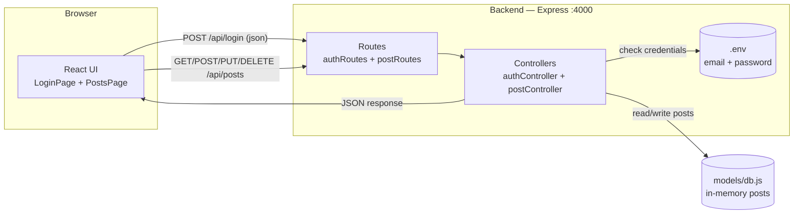
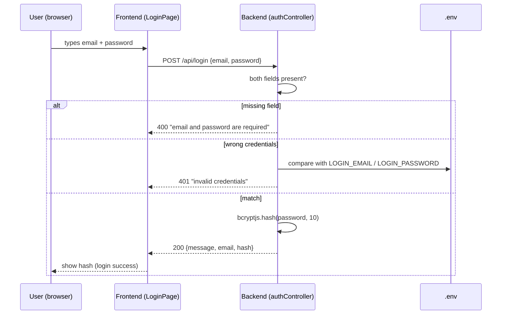
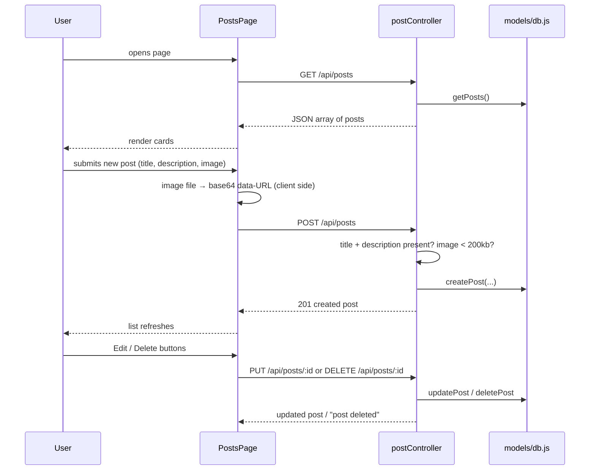
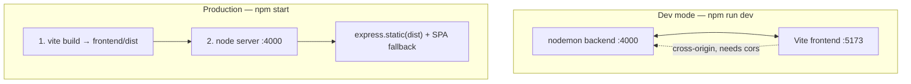

# vite_express_web v1 — Everything about the project

A simple full-stack app: **one fixed login + create/read/update/delete posts.**
Two halves talk over HTTP: an Express **backend** (port 4000) and a
React **frontend** (Vite, port 5173 in dev; served by the backend in prod).

---

## 1. Architecture — describe it simply

Think of it as a restaurant:

- The **frontend** is the dining room and menu. You (the browser) look at it,
  pick things (click buttons), and send orders.
- The **backend** is the kitchen. It takes the order (request), checks it,
  does the work, and sends the dish (JSON response) back.
- The **db file** (`models/db.js`) is the pantry — a simple in-memory list of
  posts. It is the **source of truth**. Restarting the server empties it back
  to the sample data (this is intentional for a learning app; the next project
  adds a real database).



### Layers (one job each — the "professional discipline" rule)

| Layer | File | Job |
|-------|------|-----|
| Route | `routes/authRoutes.js`, `routes/postRoutes.js` | URL → controller mapping only. No logic. |
| Controller | `controllers/authController.js`, `postController.js` | Reads request, does the work, sends response. |
| Model | `models/db.js` | The data. Source of truth. |
| Config | `config/env.js` | Loads `.env`, fails fast if missing. |
| Entry | `app.js` (wire-up) + `server.js` (listen) | Split so the app can be tested without listening. |

Why this split? Change one thing without touching the others. New route?
Add to routes. New logic? Controller. New field? Model. Each file stays small.

---

## 2. Data flow diagram

### Login flow



Note: the response hash is a **demo** (bcrypt of your password shown back).
Real systems never return the hash; project 2 replaces this with JWT.

### Post CRUD flow



### Image flow (why base64 is small here)

```mermaid
flowchart LR
    FILE[Image file<br/>e.g. 200KB jpg] -->|FileReader, client side| B64[base64 data-URL<br/>"data:image/png;base64,..."]
    B64 -->|POST /api/posts| LIMIT["body limit 200kb<br/>bigger → 400"]
    LIMIT --> STORE["stored as a string<br/>in db.js"]
    STORE -->|JSON + src=| RENDER[" renders it<br/>directly"]
```

The browser converts the file to a base64 **before** sending. The backend
just stores the string. The 200kb `express.json` limit is the guard rail —
base64 grows a file by ~33%, so this keeps the "small image" rule enforced.

---

## 3. High-level design + specifications

| Spec | Value |
|------|-------|
| Backend runtime | Node.js + Express 4, ES modules (`"type": "module"`) |
| Backend port | `PORT` from `.env`, default 4000 |
| Frontend | Vite 6 + React 18 + Tailwind CSS v4 |
| Frontend port (dev) | 5173 |
| Prod mode | `npm start` builds frontend, backend serves `frontend/dist` at `/` |
| Body limit | 200kb (matches "small base64 image" rule) |
| Credentials | `LOGIN_EMAIL` + `LOGIN_PASSWORD` in `.env` (gitignored) |
| Password hash | bcryptjs, 10 salt rounds (returned in login response) |
| Data store | In-memory array in `src/models/db.js` |
| API prefix | `/api` — login at `/api/login`, posts at `/api/posts` |
| IDs | Auto-increment integers (1, 2, 3…) |

### API endpoints

| Method | Route | Body | Returns |
|--------|-------|------|---------|
| POST | `/api/login` | email, password | 200 `{message, email, hash}` / 400 / 401 |
| GET | `/api/posts` | — | 200 array of posts |
| GET | `/api/posts/:id` | — | 200 post / 404 |
| POST | `/api/posts` | title, description, image? | 201 post / 400 |
| PUT | `/api/posts/:id` | any of title, description, image | 200 post / 404 |
| DELETE | `/api/posts/:id` | — | 200 `{message}` / 404 |

### Frontend pages/components

| Component | Role |
|-----------|------|
| `LoginPage` | Form → POST `/api/login` → stores returned hash |
| `PostsPage` | Loads list, owns form state, handles edit/delete |
| `PostCard` | One post: image thumb, title, description, Edit/Delete |
| `PostForm` | Create/edit form; converts image file → base64 |
| `api.js` | All fetch calls in one place (single point to change) |

---

## 4. Libraries used — and WHY this one

| Library | Why this choice | Why not the alternative |
|---------|-----------------|-------------------------|
| **Express** | The standard Node web framework. Tiny, unopinionated, middleware ecosystem. You learn HTTP properly. | Fastify/Koa are fine but Express is what 90% of tutorials/jobs assume — best first backend. |
| **bcryptjs** | Hashes passwords with salt; pure JS so it installs everywhere with no compiler. Same API as bcrypt. | Native `bcrypt` is faster but needs a native build; npm's install-script policy blocked it here. |
| **dotenv** | Loads `.env` into `process.env`. Secrets stay out of code and git. | Node 20+ has `--env-file`, but dotenv is explicit and portable. |
| **cors** | Lets the Vite dev server (5173) call the API (4000) cross-origin. | Without it the browser blocks dev-mode requests. Not needed in prod (same origin) but harmless. |
| **nodemon** | Restarts the server on file saves during dev. | Plain `node` needs manual restarts — slow feedback loop. |
| **Vite** | Dev server starts instantly, hot-reloads React. One-command production build. | Create-React-App is deprecated; Webpack needs heavy config. |
| **React 18** | Component model fits the Login/Posts split; huge ecosystem. | Vue/Svelte work too — React matches the大多数 job market and the user's stack choice. |
| **Tailwind CSS v4** | Utility classes right in the markup — no separate CSS files to maintain. Fast to make a clean UI. | Hand CSS gets messy; component libraries (MUI) add weight before you need them. |
| **concurrently** | One `npm run dev` runs backend + frontend together. | Two terminals work, but one command is fewer mistakes. |

---

## 5. Dev mode vs production mode



- **Dev:** hot reload on both sides, UI at 5173, API at 4000.
- **Prod:** one command, one port. `app.js` checks if `frontend/dist` exists;
  if yes it serves it (with `index.html` fallback for unknown GET routes);
  if no it answers 404 JSON. API routes are registered first so they always win.

---

## 6. Gotchas we hit (worth remembering)

1. **EADDRINUSE (:4000)** — an older server process was still alive, so new
   starts crashed. Fix: kill the leftover PID
   (`ss -tlnp | grep 4000` → `kill <pid>`). Prevention: `server.js` now catches
   the `error` event and prints a friendly message instead of a stack trace.
2. **bcrypt native build blocked** — npm refused the native install script.
   Solution: `bcryptjs`, pure JS, identical API for our use.
3. **Base64 is ~33% bigger** than the raw file — hence the 200kb body limit
   and the "small image" requirement.
