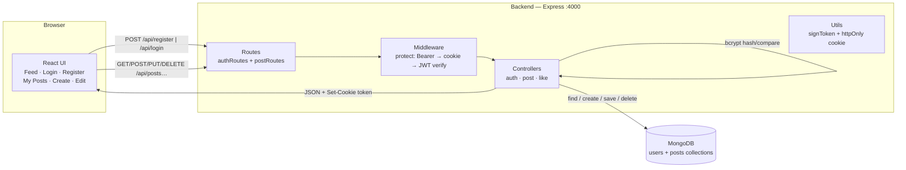
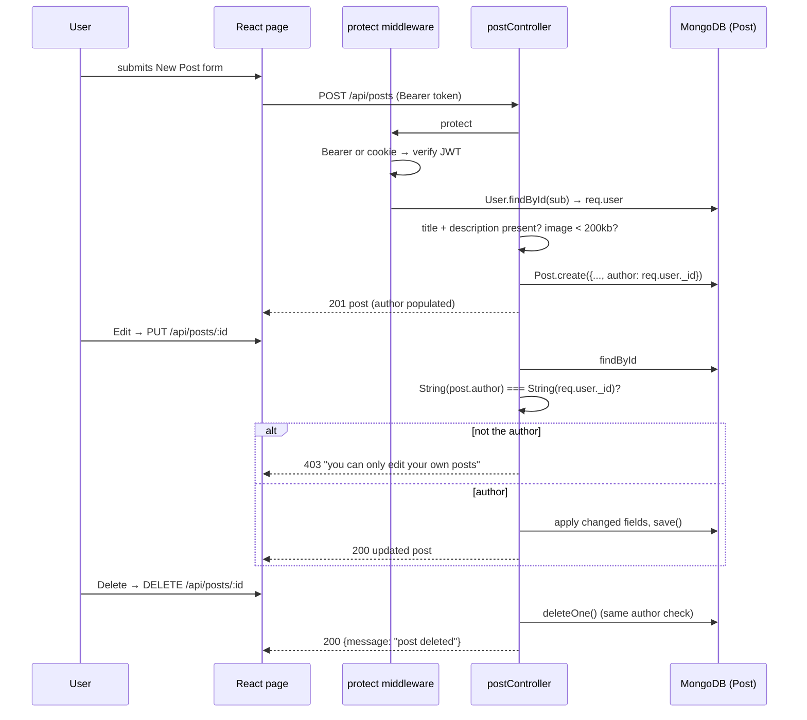
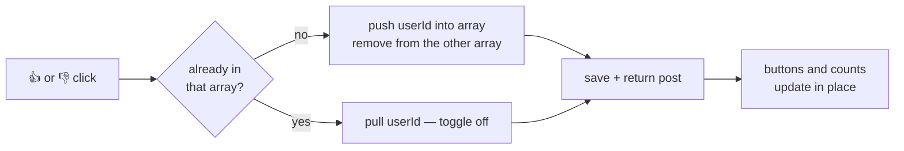
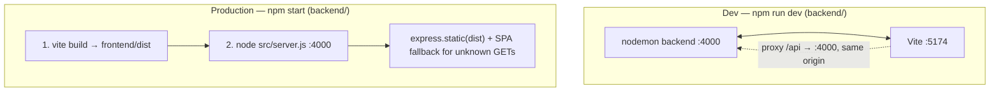

# vite_express_web_mongodb v2 — Everything about the project

Project 2, same pattern as `notes/topics/vite-express-web-v1/vite-express-web-v1.md`.
A full-stack app: **register/login + create/read/update/delete posts + like/dislike**,
backed by a real **MongoDB** instead of an in-memory array.

---

## 1. Architecture — describe it simply

Same restaurant picture as v1, with three upgrades: the pantry is now a real
database, the waiter carries an ID badge (JWT), and every dish is tied to the
person who ordered it.

- The **frontend** (React, Vite, port 5174 in dev) is the dining room: forms,
  buttons, page routing.
- The **backend** (Express, port 4000) is the kitchen: it authenticates the
  request, checks ownership, does the work, answers with JSON.
- **MongoDB** (local or Atlas `mongodb+srv://…`) is the pantry: Mongoose
  models (`User`, `Post`) are the source of truth. Restarting the server keeps
  the data.



### Layers (one job each — same discipline as v1, more files)

| Layer | File | Job |
|-------|------|-----|
| Route | `routes/authRoutes.js`, `routes/postRoutes.js` | URL → controller mapping only. No logic. |
| Middleware | `middleware/authMiddleware.js` | `protect`: read Bearer header (cookie fallback) → verify JWT → load `req.user` → 401 if anything fails. |
| Controller | `controllers/authController.js`, `postController.js`, `likeController.js` | Read request, do the work, send response. Author-only 403 checks live here. |
| Model | `models/User.js`, `models/Post.js` | The data + rules: bcrypt pre-save hook, `select: false` password, likes/dislikes arrays, count virtuals. |
| Config | `config/env.js`, `config/db.js` | Load `.env` (fail fast), connect to MongoDB. |
| Utils | `utils/token.js` | Sign/verify JWT, set/clear the httpOnly cookie. |
| Entry | `app.js` (wire-up) + `server.js` (listen) | Split so the app can be tested without listening. |

Why the split matters more than v1: auth, ownership and reactions are three
different concerns. Putting `protect` in middleware means every protected route
is one word (`router.post('/', protect, createPost)`).

---

## 2. Data flow diagram

### Register / login flow (JWT: cookie **and** Bearer)

```mermaid
sequenceDiagram
    participant U as User (browser)
    participant F as LoginPage
    participant B as authController
    participant DB as MongoDB (User)

    U->>F: types email + password
    F->>B: POST /api/login {email, password}
    B->>DB: User.findOne({email}).select("+password")
    B->>B: bcrypt.compare(plain, hash)
    alt no user or wrong password
        B-->>F: 401 "invalid credentials"
    else match
        B->>B: jwt.sign({sub: user._id}, 7d)
        B-->>F: Set-Cookie: token (httpOnly, SameSite=Lax)
        B-->>F: 200 {user: {id,name,email}, token}
        F->>F: localStorage.setItem("token", token)
        F-->>U: logged in, Navbar shows name
    end

    Note over U,B: later requests send BOTH credentials —<br/>Authorization: Bearer &lt;token&gt; (preferred) or the cookie (fallback)
```

`AuthContext` restores a session on refresh by calling `GET /api/me` when a
token exists in `localStorage`; if it fails the token is dropped.

### Post CRUD flow (author-only writes)



### Like / dislike flow (one reaction per user)



Counts come from `likeCount` / `dislikeCount` **virtuals** on the Post schema
(they exist only when the JSON is produced, never stored twice).

### Image flow — same as v1

Browser converts the file to a base64 data-URL **before** sending, backend
stores the string, `express.json({ limit: '200kb' })` rejects anything bigger
(base64 is ~33% larger than the raw file).

---

## 3. High-level design + specifications

| Spec | Value |
|------|-------|
| Backend runtime | Node.js + Express 4, ES modules (`"type": "module"`) |
| Backend port | `PORT` from `.env`, default 4000 |
| Database | MongoDB via **Mongoose 8** — `MONGODB_URI` in `.env` (local or Atlas `mongodb+srv`) |
| Collections | `users`, `posts` (post holds `author` ObjectId ref + `likes`/`dislikes` arrays) |
| Auth | register/login → bcryptjs (10 rounds) → JWT 7 days, httpOnly SameSite=Lax cookie **and** token in the response body |
| Passwords | `select: false` on the schema — never loaded unless explicitly asked |
| Frontend | Vite 6 + React 18 + Tailwind CSS v4 + react-router-dom 6 |
| Frontend port (dev) | 5174, Vite proxy sends `/api` → `:4000` (same origin → no cors needed) |
| Prod mode | `npm start` builds `frontend/dist`, backend serves it at `/` with SPA fallback |
| Body limit | 200kb (small base64 image rule, same as v1) |
| IDs | MongoDB `ObjectId` (serialized as `_id`; `id` virtual only when `virtuals: true`) |
| API prefix | `/api` — auth at `/api/register|login|logout|me`, posts at `/api/posts…` |

### API endpoints

| Method | Route | Auth | Returns |
|--------|-------|------|---------|
| POST | `/api/register` | — | 201 `{user, token}` + sets cookie / 400 / 409 |
| POST | `/api/login` | — | 200 `{user, token}` + sets cookie / 400 / 401 |
| POST | `/api/logout` | — | 200, clears cookie |
| GET | `/api/me` | ✔ | 200 `{user}` / 401 |
| GET | `/api/posts` | — | 200 array (author populated, counts) |
| GET | `/api/posts/mine` | ✔ | 200 my posts |
| GET | `/api/posts/:id` | — | 200 post / 404 |
| POST | `/api/posts` | ✔ | 201 post / 400 (missing fields or image > 200kb) |
| PUT | `/api/posts/:id` | ✔ | 200 updated / 403 not author / 404 |
| DELETE | `/api/posts/:id` | ✔ | 200 `{message}` / 403 not author / 404 |
| POST | `/api/posts/:id/like` | ✔ | 200 post (removes own dislike) |
| POST | `/api/posts/:id/dislike` | ✔ | 200 post (removes own like) |

### Frontend pages/components

| Component | Role |
|-----------|------|
| `App.jsx` | Route table; `/my-posts`, `/create`, `/edit/:id` wrapped in `ProtectedRoute` |
| `Navbar` | Feed / My Posts / New Post / Logout, shows `user.name` |
| `FeedPage` | Everyone's posts, 👍/👎 with live counts, delete **own** post |
| `MyPostsPage` | `GET /posts/mine`, Edit + Delete per card |
| `CreatePostPage` | New post form → `POST /posts` → navigate to My Posts |
| `EditPostPage` | Loads post by id, prefills form → `PUT /posts/:id` |
| `PostCard` | One post: image, title, description, author, timeAgo, reactions, Edit/Delete shown only to the author |
| `PostForm` | Shared create/edit form; file → base64 preview |
| `AuthContext` | login/register/logout, restores session via `/me` |
| `api.js` | Every fetch in one place, attaches `Authorization: Bearer` |

---

## 4. Libraries used — and WHY this one

| Library | Why this choice | Why not the alternative |
|---------|-----------------|-------------------------|
| **Express** | Same as v1 — the standard Node framework, teaches HTTP properly. | Fastify is faster, but Express is what tutorials/jobs assume. |
| **Mongoose** | Schemas, validation, `populate` (turn `author` ObjectId into a real user), hooks like the bcrypt pre-save. | The native `mongodb` driver gives no schema — you re-implement validation by hand. |
| **jsonwebtoken** | Stateless login: server signs `{sub: id}`, any later request proves identity by verifying the signature. | Storing sessions in memory/Redis works but adds infra; JWT needs nothing extra. |
| **cookie-parser** | Lets the backend read the httpOnly auth cookie on every request. | Without it the cookie fallback in `protect` cannot work. |
| **bcryptjs** | Same as v1: pure JS, no native build, salted hashes. | Native `bcrypt` blocked by npm install-script policy. |
| **dotenv** | Secrets (`MONGODB_URI`, `JWT_SECRET`) stay in gitignored `.env`. | `--env-file` exists in Node 20+, but dotenv is explicit and portable. |
| **(no cors)** | Vite's dev proxy makes API and UI same-origin — the cross-origin problem disappears. | v1 needed `cors` because it called `:4000` from `:5173` directly. |
| **concurrently** | `npm run dev` runs backend + frontend in one terminal. | Two terminals = two places to remember. |
| **Vite 6** | Instant dev server, hot reload, one-command build. | CRA is deprecated; Webpack needs heavy config. |
| **react-router-dom** | Real pages (Feed / My Posts / Create / Edit) with URLs, back button and protected routes. | v1's single PostsPage had no URLs — fine for one screen, not for six. |
| **Tailwind CSS v4** | Utility classes in markup, no separate CSS files. | Hand CSS gets messy; MUI adds weight before you need it. |

---

## 5. Dev mode vs production mode



- **Dev:** hot reload both sides; the Vite proxy means cookies and Bearer
  requests are same-origin — no cors middleware anywhere.
- **Prod:** API routes are registered first so they always win over the static
  fallback; if `frontend/dist` is missing the API still answers JSON 404.
- **`.env`** (backend/, gitignored): `PORT`, `MONGODB_URI`, `JWT_SECRET`.
  Fail-fast check in `config/env.js` — a missing variable stops startup with a
  clear message instead of a crash later.

---

## 6. Gotchas we hit (worth remembering)

1. **"Only create works" — a feature existed but was invisible (Q5).** The
   backend had `PUT`/`DELETE` and `api.js` had `updatePost`/`deletePost`, yet
   the UI showed no Edit/Delete buttons. Cause: `PostCard` compared
   `post.author.id` with `user.id`, but `User.js` did not set
   `toJSON: { virtuals: true }`, so populated author JSON contained only
   `_id, name, email` — `author.id` was `undefined` and `mine` was always
   false. **Fix:** enable virtuals on the User schema *and* compare
   `post.author._id ?? post.author.id` in the frontend (`_id` is always there).
   Lesson: curl-tested endpoints can still be unreachable in the UI — always
   verify the rendered page.
2. **Feed delete button did nothing.** `FeedPage` never passed `onDelete`, and
   `PostCard` calls `onDelete?.(post)` — an optional call, so the click was a
   silent no-op instead of an error. Wiring the handler fixed it.
3. **Stale `dist/` hides your changes.** Production serves the built bundle;
   editing `.jsx` without `npm run build` (or `npm start`, which builds first)
   leaves the old `dist/assets/index-*.js` on screen. After a frontend change,
   rebuild and confirm the new hashed filename in `dist/assets/`.
4. **`id` vs `_id`.** Mongoose's `id` virtual is serialized only when
   `virtuals: true` is set for that schema. `_id` is always present — prefer it
   for comparisons, or make the backend emit an explicit `id` (as
   `publicUser()` already does for auth responses).
5. **`pkill -f "node src/server.js"` can kill your own shell.** `pkill -f`
   matches the full command line of *every* process, including the shell
   running the pkill. Use a self-excluding pattern: `pkill -f "src/server[.]js"`.
6. **No user-deletion endpoint.** Test users created during smoke tests stay in
   the database unless removed directly through Mongoose — clean up test data
   by email, never by wiping collections.
7. **`mongodb+srv` needs network.** Atlas URLs fail fast with a connection
   timeout when offline; the local fallback is
   `mongodb://127.0.0.1:27017/<db>` with `mongod` running.
